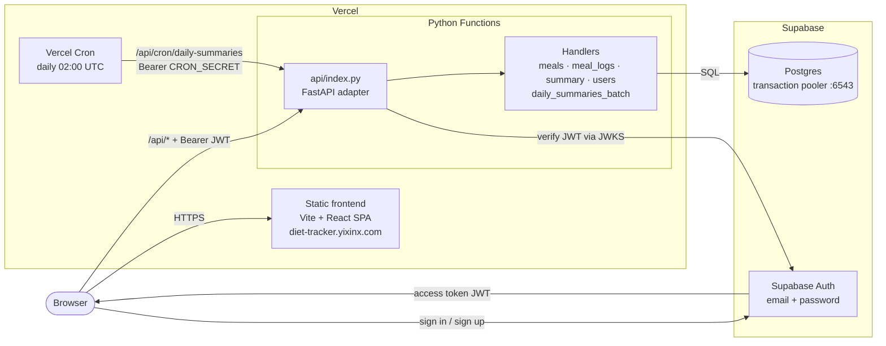

# Architecture Overview

This repository implements a small, serverless diet-tracking application on Vercel and Supabase. The goal is a secure, low-traffic system with minimal operational overhead and zero running cost.

## High-Level Flow



## Core Services
- **Frontend**: React 19 SPA built by Vercel from `frontend/` and served as static output at `diet-tracker.yixinx.com`. The API is same-origin under `/api`.
- **Auth**: Supabase Auth with email and password via `@supabase/supabase-js`. The API verifies the Supabase access token with PyJWT against the project JWKS (`/auth/v1/.well-known/jwks.json`, audience `authenticated`, issuer checked) and passes `sub` and `email` to the handlers as claims. The project must use asymmetric signing keys; legacy HS256 tokens do not verify.
- **API adapter**: `api/index.py` is a single Vercel Python Function. A FastAPI catch-all matches the request path against the nine resource templates, builds the API Gateway-style event the handlers expect (`httpMethod`, `resource`, `pathParameters`, `requestContext.authorizer.claims`), calls the handler unchanged, and converts the result back into an HTTP response.
- **Backend**: Python 3.12 handlers in `backend/lambdas/` (`meals`, `meal_logs`, `summary`, `users`, `daily_summaries_batch`). The directory name is historical; they are plain functions with no AWS dependency.
- **Data**: Supabase Postgres, reached through the transaction pooler (port 6543) via `DATABASE_URL` in `backend/shared/db.py`. Connections are cached across warm invocations. The pooler does not honor startup parameters, so none are passed. The Data API does not expose the `public` schema.
- **Batch Processing**: Vercel Cron calls `/api/cron/daily-summaries` once a day (`0 2 * * *`, at an imprecise minute on Hobby) with `Authorization: Bearer $CRON_SECRET`. The route runs `daily_summaries_batch`, which pre-computes daily calorie summaries, weekly reports, and nutrition anomaly detection. The summary API reads pre-computed data first, falling back to live calculation for same-day data. The daily run also keeps the free Supabase project from pausing.

## Handler Responsibilities
- `meals`: CRUD for meals and ingredients; manages `meal_ingredients` associations.
- `meal_logs`: Log meals by date, list logs, delete logs.
- `summary`: Calculate daily totals from logged meals. Reads from pre-computed `daily_summaries` table when available, falls back to live aggregation for same-day data.
- `users`: Create or fetch user records (keyed by `auth_user_id`) from JWT claims.
- `daily_summaries_batch`: Scheduled batch job that pre-computes daily summaries, weekly reports, and detects nutritional anomalies (calories deviating >50% from 7-day rolling average).

## Repository Layout
```
api/
  index.py          # Vercel Python Function: FastAPI adapter + cron route
backend/
  lambdas/          # Domain handlers (meals, meal_logs, summary, users, daily_summaries_batch)
  shared/           # Auth, DB, response, validation, logging, metrics helpers
  tests/            # Pytest unit + integration + smoke suites
infra/
  sql/              # Database schema
frontend/           # Vite + React SPA source
  e2e/              # Playwright E2E tests
  mock-api/         # Local mock API server for testing
loadtests/          # Locust load test script + docs
docs/               # Architecture decision records (ADRs)
.github/workflows/  # CI test workflows
vercel.json         # Build settings, /api rewrite, cron schedule
requirements.txt    # Python Function deps, pinned to backend/Pipfile.lock
```

## CI/CD Pipeline
Vercel's Git integration deploys: every pull request gets a preview deployment and every push to `main` deploys production. GitHub Actions only runs tests and holds no cloud credentials.

**Workflow structure:**
- `test-backend.yml`: Runs pytest unit + integration tests on PR/push when `backend/`, `api/`, `requirements.txt` or `vercel.json` changes.
- `test-frontend.yml`: Runs ESLint, Vitest unit tests and Playwright E2E tests on PR/push when `frontend/` changes.

**Environment separation:**
- There is no separate staging stack. Preview deployments replace it and share the production Supabase project, consistent with the shared-backend decision in ADR-013. See ADR-014 in [`docs/architecture-decisions.md`](docs/architecture-decisions.md).

## Observability
- **Structured logging**: All handlers emit JSON-formatted logs via a custom `StructuredLogger` (`backend/shared/logging.py`). They land in Vercel's function logs and can be filtered by user_id, operation, or error type.
- **Log-only metrics**: `backend/shared/metrics.py` emits metrics under the `DietTracker` namespace (request latency, DB query time) as structured log lines. Wrapped in try/except so monitoring failures never crash the application.
- **Alerting**: None. The CloudWatch alarms were removed with the AWS stack; Vercel's dashboard shows function errors and cron run history.

## Testing Strategy
- **Backend**: pytest unit tests (handler logic, shared modules, the FastAPI adapter) and integration tests. Run in CI on every PR and push.
- **Frontend**: ESLint, Vitest unit tests for the auth module, and Playwright E2E tests against a local mock API server (`frontend/mock-api/server.js`) with `VITE_AUTH_BYPASS=true`. Playwright reports uploaded as CI artifacts.
- **Load testing**: Locust-based performance tests (`loadtests/locustfile.py`) simulating realistic user sessions with weighted read/write patterns. Automatic test data cleanup and a 5% error rate threshold.
- **Mock API trade-off**: E2E tests are fast and deterministic but don't validate the full stack. Backend tests and manual checks on preview deployments fill this gap. See ADR-012.

## Deployment Notes
Vercel environment variables:

| Scope | Variable | Value |
|---|---|---|
| Functions | `DATABASE_URL` | Supabase transaction-pooler URI, port 6543 |
| Functions | `SUPABASE_URL` | `https://<ref>.supabase.co` |
| Functions | `ALLOWED_ORIGIN` | `https://diet-tracker.yixinx.com` |
| Functions | `CRON_SECRET` | random 32+ chars |
| Build | `VITE_API_BASE_URL` | `/api` |
| Build | `VITE_SUPABASE_URL` | same as `SUPABASE_URL` |
| Build | `VITE_SUPABASE_ANON_KEY` | the project's publishable key |

`LOG_LEVEL` is optional. The Supabase project needs asymmetric JWT signing keys, `infra/sql/schema.sql` applied, `public` removed from the Data API's exposed schemas, and Auth URL Configuration covering `https://diet-tracker.yixinx.com`, preview URLs and `http://localhost:5173`. The custom domain is a Cloudflare CNAME to `cname.vercel-dns.com` with proxying off. The README's Deployment section has the step-by-step setup.

## Local Development Notes
- The frontend can run against a mock API server in `frontend/mock-api/server.js`.
- `VITE_AUTH_BYPASS=true` skips Supabase with a fake signed-in session for local E2E tests.
- `vercel dev` runs the frontend and the Python Function together against the real Supabase project.

## Architecture Decisions
All major technical decisions are documented as Architecture Decision Records (ADRs) in [`docs/architecture-decisions.md`](docs/architecture-decisions.md), covering compute, data, auth, frontend, CI/CD, observability, testing, and cost optimization trade-offs. ADR-014 records the move from AWS to Vercel and Supabase and lists the ADRs it supersedes.
