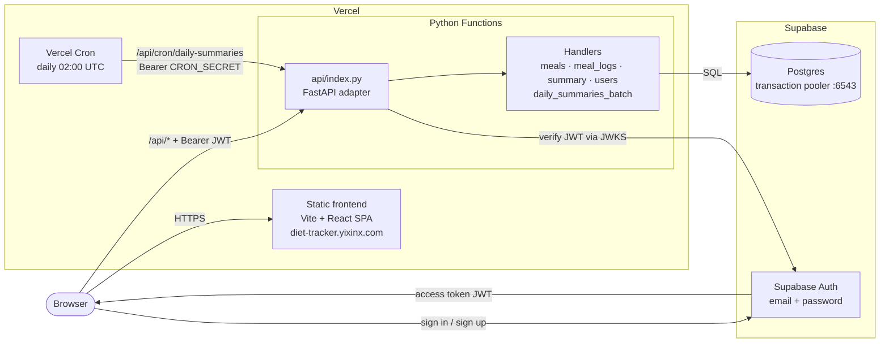

# Diet Tracker – Serverless Vercel + Supabase Application

A personal, zero-cost, serverless diet tracking web application. The app allows authenticated users to create reusable meals (recipes), define ingredients with calorie values, log meals per day, and automatically calculate daily calorie intake.

The frontend and API run on Vercel (Hobby), and Postgres and Auth run on Supabase (free plan). The backend keeps its original Lambda-style handlers behind a thin FastAPI adapter, so the business logic and its tests are unchanged from the AWS version.

---

## 🏗️ Architecture Overview



### Key Security Properties

* No database credentials or service keys in the browser (the Supabase publishable key is public by design)
* JWT-based authentication only; the API verifies every token against Supabase's JWKS (audience `authenticated`, issuer checked)
* All database access happens server-side in the Python Functions
* Supabase Data API does not expose the `public` schema, so tables are reachable only through the API
* Secrets live in Vercel environment variables, never in code

For detailed reasoning behind every architectural decision, see [`docs/architecture-decisions.md`](docs/architecture-decisions.md) (ADR-014 covers the move to Vercel and Supabase).

---

## 🧱 Tech Stack

### Frontend

* Vite + React 19 (SPA)
* Hosted on Vercel as static output (`frontend/dist`)
* Custom domain: `diet-tracker.yixinx.com` (Cloudflare DNS CNAME to Vercel)
* `@supabase/supabase-js` for sign-in, sign-up and session refresh

### Backend

* Vercel Python Functions (Python 3.12)
* FastAPI adapter (`api/index.py`) that builds the API Gateway-style event the existing handlers expect
* Supabase Postgres via `psycopg2`, connecting through the transaction pooler (`DATABASE_URL`)
* Vercel Cron for the nightly `daily_summaries` batch

### Authentication & Security

* Supabase Auth (email + password, optional email confirmation)
* Asymmetric JWT signing keys (RS256/ES256) verified with PyJWT against the project JWKS
* Cron route guarded by `Authorization: Bearer $CRON_SECRET`
* CORS restricted to `ALLOWED_ORIGIN`

### Infrastructure & CI/CD

* Vercel Git integration: preview deployments on pull requests, production on `main`
* GitHub Actions run the test suites on PRs and pushes to `main` (path-filtered)
* Previews and production share one Supabase project

### Testing & Quality

* Backend: pytest unit + integration tests (including adapter tests) with coverage reporting
* Frontend: ESLint, Vitest unit tests, and Playwright E2E tests against a local mock API
* Load testing: Locust-based performance tests simulating realistic user sessions
* Playwright reports uploaded as GitHub Actions artifacts (30-day retention)

### Observability

* Structured JSON logging via custom `StructuredLogger`, visible in Vercel function logs
* Log-only metrics under the `DietTracker` namespace (request latency, DB query time) emitted as structured log lines

---

## 🔐 Authentication Flow

1. User opens the app and sees the sign-in form
2. User signs in (or signs up) with email and password through `supabase-js`
3. If email confirmation is on, the confirmation link returns to the app origin and `supabase-js` picks up the session from the URL
4. Supabase returns an access token (JWT) and refresh token; `supabase-js` stores and refreshes them
5. The frontend sends the access token as `Authorization: Bearer <JWT>` on every `/api` request
6. The FastAPI adapter verifies the token against `https://<ref>.supabase.co/auth/v1/.well-known/jwks.json` and passes `sub` and `email` to the handlers as claims
7. On first sign-in, `POST /users/bootstrap` creates the `users` row keyed by `auth_user_id`

Signing out clears the Supabase session and all data loaded for that user in the browser.

---

## 🧪 Local Development & Testing

### Frontend

* Copy `frontend/.env.example` to `frontend/.env.local` and fill in `VITE_SUPABASE_URL` and `VITE_SUPABASE_ANON_KEY`.
* `VITE_API_BASE_URL` defaults to `/api`; point it at `http://localhost:8787` to use the mock API.
* A mock API server lives at `frontend/mock-api/server.js`; `npm run mock-api` starts it.
* `npm test` runs the Vitest unit tests.
* `npm run test:e2e` starts the dev server + mock API and runs Playwright tests in `frontend/e2e`.
* `VITE_AUTH_BYPASS=true` skips Supabase with a fake signed-in session (set automatically for E2E).

### Full stack

`vercel dev` from the repo root serves the frontend and the Python Function together, using the env vars in the Vercel table below (pull them with `vercel env pull`).

### Load Testing

Run the Locust load test suite against a live deployment:

```bash
pip install locust
export AUTH_TOKEN="<valid-supabase-access-token>"
locust -f loadtests/locustfile.py \
    --host https://diet-tracker.yixinx.com/api \
    --headless -u 10 -r 2 -t 60s
```

The test simulates realistic user sessions (weighted toward reads), cleans up test data on completion, and fails the run if the error rate exceeds 5%. See `loadtests/README.md` for details.

---

## 🗄️ Database Schema (PostgreSQL)

Canonical DDL lives in `infra/sql/schema.sql`.

### users

* `id (UUID, PK)`
* `auth_user_id (unique)` — Supabase Auth user id (`sub`)
* `email (unique)`
* `created_at`

### ingredients

* `id (UUID, PK)`
* `user_id (FK → users)`
* `name`
* `calories_per_unit`
* `unit`

### meals (recipes)

* `id (UUID, PK)`
* `user_id (FK → users)`
* `name`
* `total_calories`
* `created_at`

### meal_ingredients

* `id (UUID, PK)`
* `meal_id (FK → meals)`
* `ingredient_id (FK → ingredients)`
* `quantity`

### meal_logs

* `id (UUID, PK)`
* `user_id (FK → users)`
* `meal_id (FK → meals)`
* `date (date)`
* `quantity`

---

## 🔌 API Endpoints

Below is the **complete set of API endpoints** required to support the application. All endpoints live under `/api` and require a valid **Supabase Auth access token**.

---

### 🍽️ Meals & Ingredients

**Handler:** `backend/lambdas/meals`

#### Ingredients

| Method | Endpoint            | Description             |
| ------ | ------------------- | ----------------------- |
| POST   | `/ingredients`      | Create a new ingredient |
| GET    | `/ingredients`      | List all ingredients    |
| PUT    | `/ingredients/{id}` | Update an ingredient    |
| DELETE | `/ingredients/{id}` | Delete an ingredient    |

#### Meals (Recipes)

| Method | Endpoint      | Description                    |
| ------ | ------------- | ------------------------------ |
| POST   | `/meals`      | Create a meal with ingredients |
| GET    | `/meals`      | List meals                     |
| GET    | `/meals/{id}` | Get meal details               |
| PUT    | `/meals/{id}` | Update a meal                  |
| DELETE | `/meals/{id}` | Delete a meal                  |

List endpoints support optional pagination query params: `limit` and `offset`.

---

### 🗓️ Meal Logs

**Handler:** `backend/lambdas/meal_logs`

| Method | Endpoint          | Description                            |
| ------ | ----------------- | -------------------------------------- |
| POST   | `/meal-logs`      | Log a meal for a specific date         |
| GET    | `/meal-logs`      | List logged meals (filterable by date) |
| DELETE | `/meal-logs/{id}` | Delete a logged meal                   |

`/meal-logs` supports optional `from` and `to` date filters plus `limit` and `offset`.

---

### 📊 Daily Summary

**Handler:** `backend/lambdas/summary`

| Method | Endpoint                                       | Description                    |
| ------ | ---------------------------------------------- | ------------------------------ |
| GET    | `/daily-summary?date=YYYY-MM-DD`               | Total calories for a day       |
| GET    | `/daily-summary?from=YYYY-MM-DD&to=YYYY-MM-DD` | Calorie totals over date range |

---

### 👤 User Bootstrap (Optional)

**Handler:** `backend/lambdas/users`

| Method | Endpoint           | Description                        |
| ------ | ------------------ | ---------------------------------- |
| POST   | `/users/bootstrap` | Create user record from JWT claims |
| GET    | `/users/me`        | Get current user profile           |

---

### ⏰ Scheduled Batch

| Method | Endpoint                     | Description                                                     |
| ------ | ---------------------------- | --------------------------------------------------------------- |
| GET    | `/api/cron/daily-summaries`  | Pre-compute `daily_summaries` (Vercel Cron, `Bearer $CRON_SECRET`) |

---

### 🔒 Authentication Notes

* Sign-up and sign-in are handled by **Supabase Auth** in the browser
* No `/login`, `/logout`, or `/register` endpoints are required
* JWT tokens must be sent as:

  ```http
  Authorization: Bearer <JWT>
  ```

---

## 📁 Repository Structure

```text
diet-tracker/
├── api/
│   └── index.py             # Vercel Python Function: FastAPI adapter + cron route
│
├── frontend/                # Vite + React SPA
│   ├── src/
│   │   ├── auth/            # Supabase Auth helpers + sign-in/sign-up form
│   │   ├── api/             # API client wrappers
│   │   ├── App.jsx
│   │   ├── App.css
│   │   └── index.css        # Design system (CSS custom properties)
│   ├── e2e/                 # Playwright E2E tests
│   ├── mock-api/            # Local mock API server for testing
│   ├── .env.example
│   ├── playwright.config.js
│   └── package.json
│
├── backend/
│   ├── lambdas/
│   │   ├── meals/           # Ingredients + meals CRUD
│   │   ├── meal_logs/       # Meal logging
│   │   ├── summary/         # Daily/range calorie summaries
│   │   ├── users/           # User bootstrap + profile
│   │   └── daily_summaries_batch/  # Scheduled batch pre-computation
│   ├── shared/
│   │   ├── db.py            # Postgres connection from DATABASE_URL
│   │   ├── auth.py          # Supabase JWT verification + claim helpers
│   │   ├── response.py      # JSON + CORS responses
│   │   ├── validation.py    # UUID/date validation helpers
│   │   ├── logging.py       # Structured JSON logger
│   │   └── metrics.py       # Log-only custom metrics
│   ├── tests/               # Pytest unit + integration + smoke suites
│   ├── Pipfile
│   └── Pipfile.lock
│
├── infra/
│   └── sql/                 # Database schema
│
├── loadtests/
│   ├── locustfile.py        # Locust load test script
│   └── README.md            # Load testing documentation
│
├── docs/
│   └── architecture-decisions.md  # ADRs (14 decisions)
│
├── .github/
│   └── workflows/
│       ├── test-backend.yml       # PR/push: pytest suite
│       └── test-frontend.yml      # PR/push: ESLint + Vitest + Playwright
│
├── vercel.json              # Build settings, /api rewrite, cron schedule
├── requirements.txt         # Python Function deps (pinned to backend/Pipfile.lock)
├── ARCHITECTURE.md
├── README.md
└── CLAUDE.md
```

---

## 🧪 Local Development

### Frontend

```bash
cd frontend
npm install
npm run dev
```

### Backend

```bash
cd backend
pipenv install --dev
pipenv run pytest
```

---

## 🚀 Deployment

Vercel's Git integration builds and deploys the app; there are no deploy workflows in GitHub Actions.

### CI/CD Pipeline

```
Pull request
  ├── Test Backend (pytest unit + integration) ─── if backend/, api/, requirements.txt or vercel.json changed
  ├── Test Frontend (ESLint + Vitest + Playwright E2E) ─── if frontend/ changed
  └── Vercel preview deployment (shares the production Supabase project)

Push to main
  ├── Same test workflows
  └── Vercel production deployment to diet-tracker.yixinx.com
```

`vercel.json` installs and builds `frontend/` (output `frontend/dist`), rewrites `/api/(.*)` to the `api/index.py` function, and registers the daily cron at `0 2 * * *`. Hobby runs daily crons at an imprecise minute within that hour.

### Vercel Environment Variables

| Scope | Variable | Value |
|---|---|---|
| Functions | `DATABASE_URL` | Supabase transaction-pooler URI, port 6543 |
| Functions | `SUPABASE_URL` | `https://<ref>.supabase.co` |
| Functions | `ALLOWED_ORIGIN` | `https://diet-tracker.yixinx.com` |
| Functions | `CRON_SECRET` | random 32+ chars |
| Build | `VITE_API_BASE_URL` | `/api` |
| Build | `VITE_SUPABASE_URL` | same as `SUPABASE_URL` |
| Build | `VITE_SUPABASE_ANON_KEY` | the project's publishable key |

`LOG_LEVEL` is optional (default `INFO`).

### One-time Setup

1. **Supabase project.** Create the `diet-tracker` project in `us-east-1` and run `infra/sql/schema.sql` in the SQL editor. Under Settings, API, remove `public` from the exposed schemas.
2. **JWT signing keys.** Under Project Settings, JWT Keys, switch the project to asymmetric signing keys (RS256 or ES256). Tokens signed with the legacy HS256 shared secret are not published in the JWKS and will not verify.
3. **Auth URLs.** Under Authentication, URL Configuration, set the Site URL to `https://diet-tracker.yixinx.com` and add Redirect URLs for production, Vercel previews (for example `https://*-<team>.vercel.app/**`), and `http://localhost:5173/**`.
4. **Vercel project.** Import the repo, leave the root directory as the repo root (`vercel.json` supplies the build settings), and add the environment variables above.
5. **Domain.** Add `diet-tracker.yixinx.com` in Vercel, then point the Cloudflare `diet-tracker` CNAME at `cname.vercel-dns.com` with proxying off (DNS only).
6. **Verify.** Sign up, sign in, create an ingredient and a meal, log it, read the daily summary, then call the cron route manually and confirm a `daily_summaries` row appears:

   ```bash
   curl -H "Authorization: Bearer $CRON_SECRET" https://diet-tracker.yixinx.com/api/cron/daily-summaries
   ```

---

## 💰 Cost Considerations

Runs at $0/month on free plans:

* Vercel Hobby: static hosting, Python Functions and one daily cron
* Supabase free: Postgres (500 MB) and Auth
* Cloudflare DNS: free

Only the `yixinx.com` domain costs money (about $10/year). Free Supabase projects pause after 7 days without database activity; the daily cron touches the database, which keeps the project active.

---

## 🧭 Project Goals

* Simple, personal-use diet tracking with accurate calorie calculation
* Secure-by-default architecture (verified JWTs, server-side database access, no exposed Data API)
* CI with test gates on every PR, preview deployments for review
* Observability through structured logging and log-based metrics
* Zero running cost on free plans
* Documented architectural decisions with clear trade-off reasoning

---

## 📌 Future Enhancements (Optional)

* Separate Supabase project for previews
* Scheduled `pg_dump` backups (Supabase free has no automatic backups)
* Direct uploads for meal/ingredient images via Supabase Storage

---

## 📄 License

MIT (or your preferred license)
